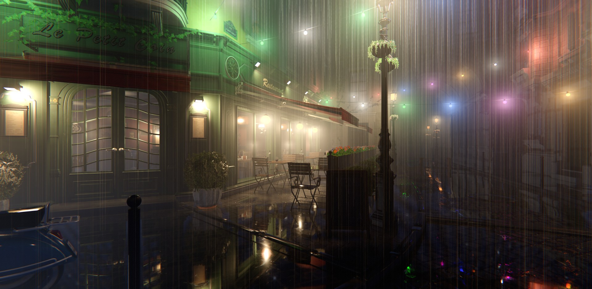
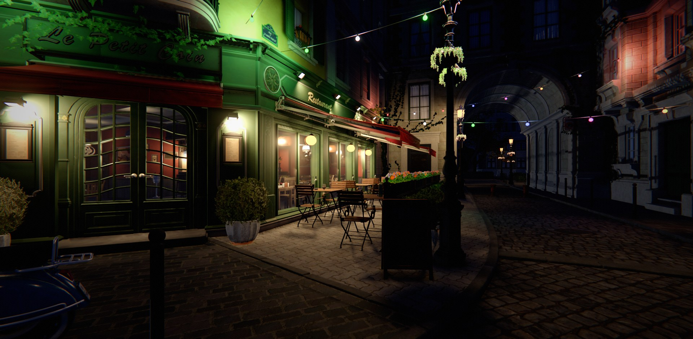

# GamEngine

GamEngine is a modern, experimental 3D game engine built on Vulkan 1.4, SDL3 and Slang, with third-party libraries
used where they make sense (PhysX, VMA, Dear ImGui). The renderer is GPU driven: culling, draw generation, light
binning and most of the frame are built on the GPU, keeping CPU overhead low.





*Amazon Lumberyard Bistro (exterior + interior), 160 local lights, rendered in the standalone Player on an RTX 3050
Laptop GPU.*

## DEMO

https://github.com/user-attachments/assets/890f518c-f8e2-4121-b0ee-bb9da5fcbfc0

## Features

### Geometry and culling

- GPU-driven pipeline: instance and meshlet culling, binning and indirect draw generation on the GPU
- Mesh-shader path with an indexed-draw fallback (`--no-mesh-shaders`)
- Hi-Z occlusion culling
- Visibility buffer: the depth prepass writes triangle IDs, tiles are classified per material class and each class is
  shaded by its own compute program
- Virtual texturing
- Render graph with automatic barriers, pass culling and async compute / async transfer queues

### Lighting and shadows

- PBR with multi-scattering specular and IBL
- VSM - custom implementation of Virtual Shadow Maps for the sun
- Clustered and tiled light culling for hundreds of local lights
- Deferred local lighting with stochastic light sampling and temporal accumulation
- Ray-traced local light shadows with a denoiser
- RTCS - ray-traced contact shadows
- Ray tracing on clustered geometry (partitioned TLAS) with opacity micromaps

### Global illumination and reflections

- DDGI probe volumes
- SSGI - screen-space global illumination
- GTAO - ground-truth ambient occlusion
- SSR with Hi-Z tracing, reflection probes and sky fallback

### Effects and post-processing

- Glass with refraction
- Rain with wet surfaces, puddles and ripples
- Volumetric fog
- GPU particle system
- Grass and foliage
- Terrain with layered materials
- Experimental Virtual Water System (in progress)
- TAA / MSAA, bloom, auto exposure, ACES tonemapping

### Engine

- Native C++ scripting with hot reload
- NVIDIA PhysX integration
- Asset manager / cooker and compressor
- Projects and standalone game builds
- Task scheduler
- CPU and GPU profiler (timestamps and Vulkan debug labels for Nsight)

### Editor

- Scene view and scene hierarchy
- Component inspector
- Asset manager
- Shader graph
- Profiler, console and terminal panels

## Performance

Bistro Night Wet from the screenshot above, RTX 3050 Laptop GPU (hybrid laptop, display on the integrated GPU),
1920x940, TAA, High shadows/GTAO/IBL. Median GPU time over 300 frames, measured with the Player's benchmark mode and
`--sequential-compute` so every pass has its own timestamps.

| Pass | GPU time (ms) |
|---|---:|
| Forward (visibility resolve, SSR, deferred local lights) | 4.8 - 5.9 |
| Deferred Local Lights | 1.57 |
| SSGI | 1.42 |
| Depth Prepass | 1.29 |
| Culling (clustered lights + objects) | 1.19 |
| Glass | 1.04 |
| GTAO | 0.92 |
| Local Light Shadows + denoise | 1.14 |
| Volumetric Fog | 0.59 |
| Directional Visibility (VSM) | 0.50 - 0.56 |
| TAA | 0.52 |
| Rain | 0.33 |
| **Frame** | **15.3 - 16.1** |

Ranges are run-to-run differences. On a hybrid laptop the driver copies every presented frame to the integrated GPU,
and the first pass that waits on that copy absorbs about 1 ms: usually Culling, sometimes also the visibility
resolve.

To measure a scene yourself:

```bash
./out/build/linux-profile/Player/GamEnginePlayer --project <project>/GamEngine.project \
    --scene Assets/Scenes/<scene>.scene --width 1920 --height 1080 \
    --sequential-compute --benchmark 300 --benchmark-warmup 400 --benchmark-output bench.csv
```

`--screenshot <file.png> --screenshot-frame <n>` saves a frame. Every pass also carries a Vulkan debug label, so
Nsight Systems (`nsys profile -t vulkan-annotations`) and Nsight Graphics GPU Trace show the same pass names.

## Build

### Requirements

- Windows 11 x64 or Linux x86-64 - tested on Ubuntu 26.04
- C++ compiler - MSVC 2022 recommended for Windows
- Cmake 4.4+
- Vulkan SDK
- Slang
- SDL3
- GLM

### Building

Clone:
```bash
git clone https://github.com/B4rtekk1/GamEngine.git
cd GamEngine
```

Linux:
```bash
cmake --preset linux-release
cmake --build --preset linux-release --parallel "$(nproc)"
./out/build/linux-release/Editor/Editor
```

Windows:
```bash
cmake --preset release
cmake --build --preset release
.\out\build\release\Editor\Debug\Editor.exe
```

## Contributing

See [CONTRIBUTING.md](CONTRIBUTING.md).

## License

Licensed under the [Apache License 2.0](LICENSE).
